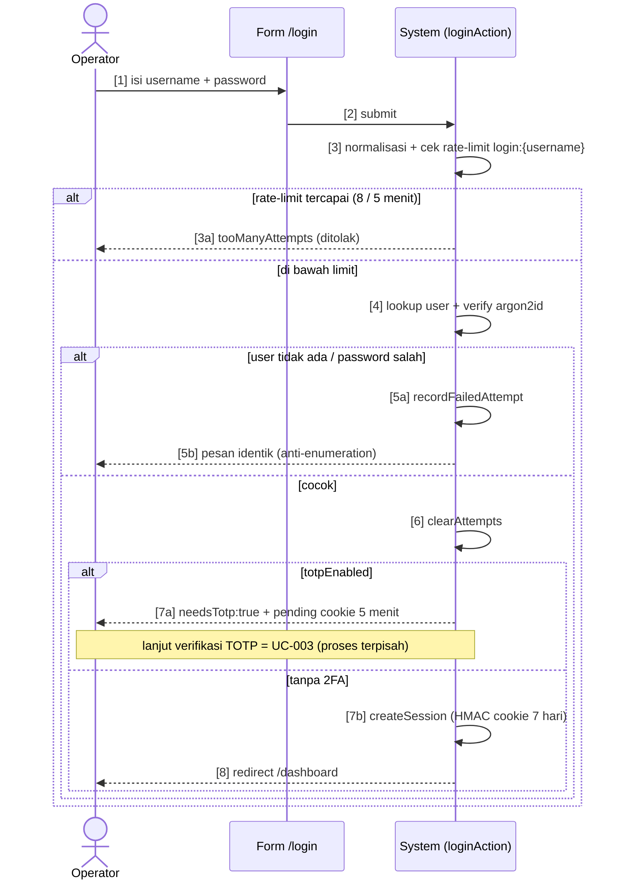

# Process Flows — BAB-1 Otentikasi & Akun

Chapter ini memuat dua proses inti autentikasi: **login dengan challenge 2FA** (jalur kritis utama) dan **reset password tanpa SMTP**. Proses lain (setup, enroll TOTP, API token) tercakup ringkas di `USE-CASE.md`.

> PF-001–PF-002 nomor global sequential. Format notasi mengikuti `00-Global/NOTATION.md` (GLOBAL-00): Flowchart = ASCII · Sequence/Activity/BPMN = Mermaid.

## PF-001: Login dengan Challenge 2FA

Proses verifikasi kredensial operator sampai session cookie terbit, termasuk cabang challenge 2FA.

**Trigger:** Operator mengirim form `/login`.
**Goal:** Session `kitab_session` yang valid (HMAC, 7 hari) — atau challenge TOTP bila 2FA aktif.

**Actors:**
- Operator: mengisi username + password (dan kode TOTP bila diminta)
- System: server action login + argon2id + rate-limit

### Flow (Flowchart — ASCII)

```
START
  |
  v
[1] Operator isi username + password di /login
  |
  v
[2] System normalisasi (trim + lowercase)
  |
  v
[3] Rate-limit "login:{username}" tercapai (8 / 5 menit)?
  +--- YA ---> [3a] balas tooManyAttempts -----> END (ditolak)
  |
  +--- TIDAK -+
              v
[4] Cari user by username
  |
  v
[5] User ada?
  +--- TIDAK --> [5a] recordFailedAttempt --+ 
  |                                          | pesan IDENTIK
  +--- YA ----> [6] verify argon2id          | (anti-enumeration)
       |          +--- SALAH --> [6a] recordFailedAttempt
       |                                  |
       v                                  v
[7] clearAttempts                    END (ditolak)
       |
       v
[8] totpEnabled?
  +--- YA ---> [8a] grant pending-2FA (cookie 5 menit)
  |                balas {needsTotp:true} --> END (lanjut UC-003)
  |
  +--- TIDAK --> [9] createSession (HMAC cookie, TTL 7 hari)
                      |
                      v
                   redirect /dashboard --> END
```

### Step Descriptions

| Step | Actor | Action | System Response |
|------|-------|--------|-----------------|
| 1 | Operator | Isi username + password | — |
| 2 | System | — | Normalisasi `trim().toLowerCase()` |
| 3 | System | — | Cek `isLockedOut("login:" + username)` (`app/login/actions.ts:31`) |
| 5–6 | System | — | Lookup user; `verify()` argon2id — user tak ada & password salah diberi **pesan sama persis** |
| 7 | System | — | `clearAttempts()` bila sukses |
| 8a | System | — | Grant pending-2FA (cookie sementara 5 menit), return `{needsTotp:true}` |
| 9 | System | — | `createSession(userId)` → `setSessionCookie` → redirect `/dashboard` |

### Decision Points

| Step | Condition | True Path | False Path |
|------|-----------|-----------|------------|
| 3 | percobaan ≥ 8 dalam 5 menit | Step 3a (tolak) | Step 4 |
| 5 | user ditemukan | Step 6 | Step 5a (gagal, pesan sama) |
| 6 | argon2id cocok | Step 7 | Step 6a (gagal) |
| 8 | `users.totpEnabled = true` | Step 8a (challenge) | Step 9 (session langsung) |

### Exception Handling

| Step | Exception | System Response | Recovery |
|------|-----------|-----------------|----------|
| 3 | Rate limit tercapai | Balas `tooManyAttemptsError` | Tunggu jendela 5 menit |
| 6 | User tak ada / password salah | `recordFailedAttempt` + pesan identik (anti-enumeration) | Coba lagi (dihitung rate-limit) |
| 8a | Setelah TOTP: secret tak bisa di-decrypt (volume tak ter-mount) | Error spesifik, **bukan 500**; backup code tetap jalan (UC-003 EF) | Mount volume / pakai backup code |

### Sequence Diagram (Mermaid) — urutan pesan login (UC-002)



---

## PF-002: Reset Password Tanpa SMTP

Proses permintaan + eksekusi reset password memakai token yang dicetak ke log container (tanpa layanan email).

**Trigger:** Operator membuka `/login/forgot-password`.
**Goal:** Password baru terpasang; token lama hangus.

**Actors:**
- Operator: meminta reset + memasukkan token dari log
- System: rate-limit, generate/verify token, update hash

### Flow (Flowchart — ASCII)

```
START
  |
  v
[1] Operator isi username di forgot-password
  |
  v
[2] System balas {sent:true} SELALU (anti-enumeration, tampil dulu)
  |
  v
[3] Rate-limit "reset-request:{username}" tercapai?
  +--- YA ---> [3a] hentikan proses (balasan tetap {sent:true})
  |
  +--- TIDAK -+
              v
[4] User ada?
  +--- TIDAK --> END (tanpa jejak — balasan sudah terlanjur sama)
  |
  +--- YA ----> [5] generateResetToken → hash → simpan
                      |
                      v
               [6] token dicetak ke log container
                   (berlaku 15 menit) --> END
  --- ---

[7] Operator ambil token dari docker logs, buka reset-password
  |
  v
[8] Validasi username + token + password baru (8–200 char)
  |
  v
[9] verifyResetToken cocok & belum lewat 15 menit?
  +--- TIDAK --> [9a] tolak --> END
  |
  +--- YA ----> [10] hash password baru (argon2id) → update
                      |
                      v
               [11] consumeResetToken (sekali pakai)
                      |
                      v
                   redirect /login --> END
```

### Step Descriptions

| Step | Actor | Action | System Response |
|------|-------|--------|-----------------|
| 2 | System | — | Balas `{sent:true}` **sebelum** cek apa pun (BR-016, `app/login/actions.ts`) |
| 3 | System | — | Rate-limit `reset-request:{username}` (`app/login/actions.ts:129`) |
| 5–6 | System | — | `generateResetToken` → dicetak ke stdout/log (`lib/auth/reset-password-token.ts`) |
| 8–11 | Operator / System | Ambil token dari log → isi form | `verifyResetToken` → update hash → `consumeResetToken` → redirect |

### Decision Points

| Step | Condition | True Path | False Path |
|------|-----------|-----------|------------|
| 3 | rate-limit tercapai | Step 3a (berhenti) | Step 4 |
| 4 | user ditemukan | Step 5 | END (tanpa aksi) |
| 9 | token valid + < 15 menit | Step 10 | Step 9a (tolak) |

### Exception Handling

| Step | Exception | System Response | Recovery |
|------|-----------|-----------------|----------|
| 4 | Username tak ada | Tidak ada aksi; balasan tetap `{sent:true}` | — (by design, anti-enumeration) |
| 9 | Token salah / kedaluwarsa / sudah dipakai | Tolak, user minta ulang | Minta reset baru dari log |
| — | Restart server sebelum token dipakai | Token in-memory hangus | Minta reset baru |

### Process Relationship Map

```
PF-001 (Login) --gagal 2FA/timeout--> PF-002 (Reset password) via link "lupa password"
PF-002 (Reset sukses) --triggers--> PF-001 (Login ulang dengan password baru)
```
