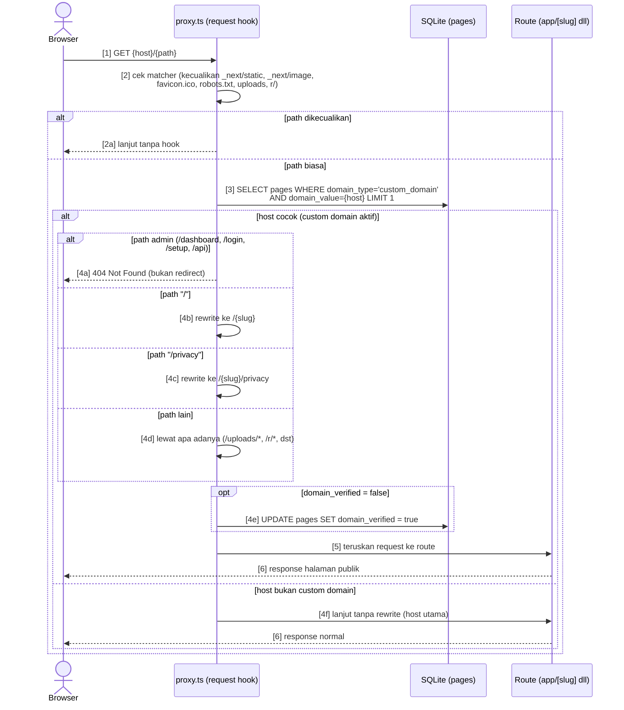

# Process Flows — BAB-2 Manajemen Page

Chapter ini memuat dua proses kritis yang menyentuh **infrastruktur request**: resolusi host custom domain di `proxy.ts` (urutan pesan presisi → Sequence Mermaid) dan unlock halaman berpassword oleh pengunjung (flowchart linear).

> PF-003–PF-004 nomor global sequential. Format mengikuti `00-Global/NOTATION.md` (GLOBAL-00).

## PF-003: Resolusi Host Custom Domain (proxy.ts)

Setiap request melewati `proxy.ts` (Next 16 request hook, Node runtime) yang meresolve `Host` ke page, memblokir path admin, dan me-rewrite path ke slug.

**Trigger:** Request HTTP masuk ke server (sebelum route di-resolve).
**Goal:** Host custom domain tampil sebagai `/{slug}`; path admin tetap tertutup di host utama.

**Actors:**
- Browser pengunjung / operator
- `proxy.ts` (Next 16 request hook)
- Database SQLite (tabel `pages`)

### Sequence Diagram (Mermaid) — urutan pesan presisi



### Step Descriptions

| Step | Actor | Action | System Response |
|------|-------|--------|-----------------|
| 2 | proxy.ts | — | Matcher kecualikan `_next/static`, `_next/image`, `favicon.ico`, `robots.txt`, `uploads`, `r/` (`proxy.ts:61-66`) |
| 3 | proxy.ts | Query 1× per request | `.limit(1)` — tanpa UNIQUE di `domainValue` (lihat BUG-005) |
| 4a | proxy.ts | — | Admin path → **404** (BR-019; tujuan: kompromi 1 domain tak membuka dashboard) |
| 4b–4d | proxy.ts | — | Rewrite `"/"` → `/{slug}`, `"/privacy"` → `/{slug}/privacy`; sisanya lewat (`proxy.ts:53-58`) |
| 4e | proxy.ts | — | Auto-verify DNS sekali saat ke-hit pertama (BR-020, `proxy.ts:49-51`) |

### Decision Points

| Step | Condition | True Path | False Path |
|------|-----------|-----------|------------|
| 2 | path termasuk yang dikecualikan | 2a (lewati hook) | Step 3 |
| 3 | host cocok `domainValue` | Step 4 (serangkaian cek path) | Step 4f (host utama) |
| 4 | path = admin | 4a (404) | 4b–4d (rewrite/lewat) |

### Exception Handling

| Step | Exception | System Response | Recovery |
|------|-----------|-----------------|----------|
| 3 | Duplikat `domainValue` (tanpa UNIQUE) | Hanya 1 page yang cocok (`.limit(1)`) — determinisme tidak dijamin | Lihat BUG-005; tidak ada guard di kode |
| 4e | Domain tak cocok DNS | `domainVerified` tetap false (tapi tetap dilayani) | Perbaiki DNS; tak ada auto-recheck |

---

## PF-004: Unlock Halaman Berpassword

Pengunjung membuka halaman publik yang diproteksi password (atau kode akses sementara) lalu mendapat cookie grant.

**Trigger:** Pengunjung membuka `/{slug}` yang punya `passwordHash`.
**Goal:** Cookie `kitab_page_{id}` (HMAC, TTL 30 hari) sehingga halaman tampil.

**Actors:**
- Pengunjung: mengisi password / kode akses
- System: `unlockPage` (argon2id + rate-limit + kode akses)

### Flow (Flowchart — ASCII)

```
START
  |
  v
[1] Pengunjung buka /{slug} berpassword → form unlock tampil
  |
  v
[2] Rate-limit "page:{pageId}" tercapai (8 / 5 menit)?
  +--- YA ---> [2a] tolak --> END
  |
  +--- TIDAK -+
              v
[3] Input kosong & ada kode akses? ---- YA --> [4] coba kode akses aktif
  |                                              (expiresAt > now, 1 per 1)
  +--- isi password ------------------------------------+
                      v                                 v
[5] verify argon2id pages.passwordHash         [4a] verify hash kode
        |                                            |
   +----+----+                                  +----+----+
   |         |                                  |         |
 COCOK     SALAH                            COCOK      HABIS
   |         |                                  |         |
   v         v                                  v         v
[6] grantPageAccess                    [6] grantPageAccess  [4b] recordFailed
    (cookie 30 hari,                            (cookie 30 hari)  → END (tolak)
     HMAC — batas atas "bukan
     password permanen kedua")
   |
   v
[7] redirect ke halaman --> END
```

### Step Descriptions

| Step | Actor | Action | System Response |
|------|-------|--------|-----------------|
| 2 | System | — | `isLockedOut("page:" + pageId)` (`app/[slug]/password-actions.ts:30`) |
| 4 | Pengunjung | Isi kode akses (opsional) | Linear compare terhadap `pageAccessCodes` yang belum expired (`password-actions.ts:43-56`) |
| 5 | System | — | Verify `pages.passwordHash` (argon2id) |
| 6 | System | — | `grantPageAccess` → cookie `kitab_page_{id}`, TTL 30 hari (`page-session.ts:13-26`) |
| 7 | System | — | Redirect ke halaman yang diminta |

### Decision Points

| Step | Condition | True Path | False Path |
|------|-----------|-----------|------------|
| 2 | ≥ 8 percobaan / 5 menit | Step 2a (tolak) | Step 3–5 |
| 4 | Ada kode akses aktif | Step 4a | Step 5 (password) |
| 4a/5 | Verifikasi cocok | Step 6 (grant) | Step 4b / gagal |

### Exception Handling

| Step | Exception | System Response | Recovery |
|------|-----------|-----------------|----------|
| 4 | Semua kode expired | Kode dilewati; kembali ke jalur password | Operator buat kode baru (UC-013) |
| 5 | Password salah | `recordFailedAttempt` → sampai limit = Step 2a | Tunggu jendela / hubungi operator |
| — | Cookie grant hilang / expired (30 hari) | Form unlock tampil lagi | Unlock ulang |

### Process Relationship Map

```
PF-003 (Host resolution) --triggers--> UC-035 render publik --> PF-004 (bila page berpassword)
PF-004 (unlock sukses) --enables--> UC-035 (lihat halaman) dan PF-009 di BAB-5 (klik link)
```
